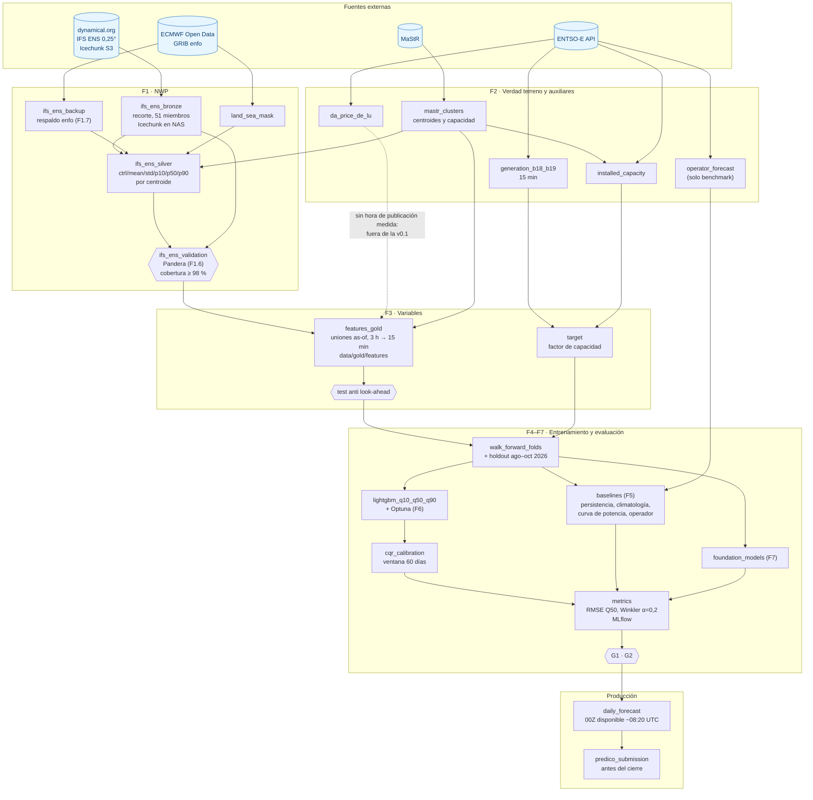
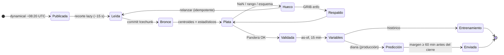

# Predico 50Hertz

[](https://github.com/r3v1/predico/actions/workflows/ci.yml)

Pronóstico probabilístico (Q10, Q50, Q90) de la generación eólica en la zona de control de 50Hertz para la liga de Predico (`germany_wind_50hertz_ca`): ingesta de datos meteorológicos (IFS ENS de ECMWF), generación y precios (ENTSO-E) y capacidad renovable (MaStR), con modelos de gradient boosting y calibración conformal.

## Dónde está cada cosa

- **Trabajo pendiente:** [milestones](https://github.com/r3v1/predico/milestones) e [issues](https://github.com/r3v1/predico/issues) de GitHub. Los milestones van numerados en el orden del calendario (`1 · G0` … `6 · Rodaje y liga`, `9 · Después del 1 dic`); cada feature es una épica con sub-issues, y el orden entre tareas está marcado con «Blocked by». Para sembrar trabajo nuevo en bloque: `.github/backlog.yaml` y `uv run python scripts/sync_github_backlog.py` (solo crea lo que falta).
- **Decisiones:** [`docs/adr/`](docs/adr/README.md), un ADR por decisión (fuente NWP, calendario y puertas, validación, cuantiles…).
- **Lo ya hecho:** [`docs/historial.md`](docs/historial.md) hasta el 20 oct 2026; desde entonces, los issues cerrados.
- **Detalle técnico por área:** `docs/` (`stage0-*`, `stage1-*`, `f1.5-f2.7-operations.md`, `f1.6-validation.md`, `f2-entsoe.md`, `f2.6-mastr.md`, `f3-features.md`, `f4-backtest.md`, `report.md`).
- **Stack técnico:** `STACK.md`. **Procedimientos ante fallos:** `docs/runbooks/`.

## Cómo arrancar

Requisitos: [uv](https://docs.astral.sh/uv/). Python 3.14 lo instala uv si no está disponible.

```bash
uv sync                          # crea .venv e instala dependencias desde uv.lock
cp .env.example .env             # configuración local (no se versiona)
uv run pytest                    # tests
uv run ruff check . && uv run ruff format --check .
uv run pyright                   # tipos estrictos en src/
```

## Ingesta NWP: IFS ENS desde dynamical.org

Fuente principal: ECMWF IFS ENS 0,25° (51 miembros, pasada 00Z, desde 2024-04-01) del Icechunk público de dynamical.org, recortado al dominio 49,5–56,0° N × 8,5–16,0° E. Decisión en el [ADR 0001](docs/adr/0001-fuente-nwp-ifs-ens-dynamical.md); detalle en `docs/stage1-dynamical.md`.

| Capa | Dónde | Contenido |
|---|---|---|
| Bronce | `/mnt/data/nwp/IFS-ENS/icechunk` (NAS, NFS) | Campos recortados, 51 miembros, pasos +18..+54 h; un commit por pasada. Un solo escritor |
| Plata | `data/silver/ifs_ens_clusters/init_date=AAAA-MM-DD/part-0.parquet` | 21 centroides de MaStR: ctrl, media, std, p10, p50, p90 por variable (273 filas por pasada). Se reconstruye desde el bronce con `python -m predico50hz.ingest.dynamical.rebuild_silver` |
| Validación | `data/validation/ifs_ens_<ini>_<fin>.json` | Informe de F1.6 |

### Grafo de datos y modelos

Vista estática del grafo de assets que tendrá Dagster (producción). Cada nodo es un asset; las flechas, dependencias. El estado de cada pieza se sigue en los milestones de GitHub.



Leyenda: azul = fuente externa. Los hexágonos son controles que bloquean el paso: si fallan, los assets de abajo no se materializan.

### Ciclo de vida de una pasada 00Z



### Descarga (F1.1–F1.4)

```bash
# Idempotente y reanudable: --skip-existing omite las pasadas ya en bronce
uv run python -m predico50hz.ingest.dynamical --start 2025-09-01 --end 2026-10-15 \
  --init-workers 2 --skip-existing --label stage2
```

Unos 10 s y ~175 MB de red por pasada; ~6 MB de bronce por pasada. Métricas en `data/stage1/dynamical_metrics.json`.

### Validación (F1.6)

```bash
# Solo lectura; sale con código 1 si la cobertura es < 98 % o falla la estructura del bronce
uv run python -m predico50hz.ingest.dynamical.validate --start 2025-09-01 --end 2026-10-15
```

- **Plata:** esquema Pandera por pasada (columnas y tipos, 273 filas, 21 centroides × 13 pasos, rangos físicos, p10 ≤ p50 ≤ p90, std ≥ 0, sin NaN salvo la racha antes del 2024-11-13).
- **Bronce:** resumen por variable y paso validado con Pandera (NaN incluido el último paso, miembros vacíos, 51 miembros, malla 27 × 31, rangos, procedencia).
- **Huecos:** cada día del rango queda cubierto o con su causa (`no_ingerida`, `plata_ausente`, `nan`, `fuera_de_rango`, `falla_esquema`), y la cobertura se compara con el 98 %.

Conviene lanzarlo con la ingesta parada: si corre a la vez, lee el snapshot del bronce del arranque. Umbrales, decisiones y limitaciones en `docs/f1.6-validation.md`.

El histórico se descarga por etapas ([ADR 0004](docs/adr/0004-descarga-del-historico-por-etapas.md)); el avance de cada una está en `docs/historial.md` y en el milestone `3 · G1`.

## Ingesta ENTSO-E (F2)

Token en `.env` como `ENTSOE_API_KEY` (ver `.env.example`); nunca se escribe en logs ni ficheros. Detalle en `docs/f2-entsoe.md`.

```bash
uv run python -m predico50hz.ingest.entsoe --dataset all                                       # histórico completo
uv run python -m predico50hz.ingest.entsoe --dataset all --days 3                              # diaria
```

| Dataset | Área | Desde | Resolución | Plata |
|---|---|---|---|---|
| `generation` (B18 + B19) | `10YDE-VE-------2` | 2015-01-01 | 15 min | `data/silver/entsoe/generation` |
| `capacity` | `10YDE-VE-------2` | 2015 | anual | `data/silver/entsoe/capacity` |
| `prices` (SDAC) | DE-LU `10Y1001A1001A82H` | 2018-10-01 | 60 min → 15 min desde 2025-10-01 | `data/silver/entsoe/prices` |
| `forecast` (operador, solo benchmark) | `10YDE-VE-------2` | 2015-01-01 | 15 min | `data/silver/entsoe/forecast` |

- **Bronce:** respuestas crudas comprimidas en `data/bronze/entsoe/<dataset>/fetched_at=<UTC>/`, una por descarga, para medir revisiones (F2.7).
- **Plata:** Delta Lake idempotente; cada valor lleva su origen (`original`, `a03` = arrastrado porque la API no repite valores iguales, `gap`) y `first_seen_at`.
- **Validación:** Pandera, informes en `data/validation/entsoe_<dataset>.json`.
- **Ojo:** la capacidad anual de ENTSO-E va retrasada (la generación marina la supera en varios años): el denominador del factor de capacidad saldrá de MaStR (F2.6). El pronóstico del operador no está publicado antes del cierre: solo benchmark.

## Aerogeneradores y clústeres: MaStR (F2.6)

```bash
uv run python -m predico50hz.ingest.mastr --download   # export completo más reciente (ZIP ~3 GB al NAS)
```

- **Crudo:** `/mnt/data/mastr/raw/<fecha_export>/` (NAS). Se parsean solo `EinheitenWind`, `Netzanschlusspunkte` y `Katalogwerte`.
- **Zona:** por `RegelzoneNetzanschlusspunkt` (50Hertz); el Bundesland solo como respaldo.
- **Clústeres:** 16 terrestres (k-means ponderado por potencia) + 5 marinos (Báltico) en `config/centroids.yaml`.
- **Plata:** `data/silver/mastr/{units,clusters,capacity_cluster,capacity_total}` (Delta). La capacidad diaria por clúster es el denominador del factor de capacidad; la anual de ENTSO-E no se usa.
- Detalle, tabla de clústeres y comparación con ENTSO-E en `docs/f2.6-mastr.md`.

## Informe ejecutivo

```bash
uv run python -m predico50hz.report      # genera report/index.html (autocontenido, ~2 MB; se abre sin red)
```

Página única, sin jerga, para negocio: estado del plan, mapa de aerogeneradores y grupos, fuentes, viaje del dato, calidad, viento y producción, reloj diario, riesgos y modelo. Todas las cifras salen de los datos reales y el avance del plan se lee de los milestones e issues de GitHub (con una copia local por si no hay red). Se versionan el generador (`src/predico50hz/report/`) y los textos editables (`report/changelog.yaml`, `report/insights.yaml`, …); el HTML no. **En cada evolutivo:** añadir su entrada a `report/changelog.yaml`, revisar `report/insights.yaml` y regenerar. Detalle en `docs/report.md`.

## Capa de variables (F3)

```bash
uv run python -m predico50hz.features                 # reconstruye data/gold/features desde la plata y valida
uv run python -m predico50hz.features --start 2026-10-01 --end 2026-10-15   # solo esas fechas de cierre
uv run python -m predico50hz.features --validate-only
```

- **Una fila por intervalo de 15 min del día objetivo** (día local D+1: 96 pasos, 92 o 100 en los cambios de hora) y por `forecast_issue_date` D (día del cierre, 15:00 de Berlín = 13:00 UTC en verano y 14:00 UTC en invierno).
- **Variables** (239): viento a 100 m por clúster (ctrl, media, cuantiles, dispersión), agregados ponderados por la capacidad MaStR de la fecha (v³, buje a 119/104 m, cizalladura, densidad, estabilidad, racha, dirección, dispersión espacial), capacidad, calendario local y plazo.
- **Objetivo** `y_*`: generación en MW y factor de capacidad con la capacidad MaStR del día. El pronóstico del operador y el precio no entran.
- **Look-ahead:** cada bloque lleva su `available_at_*`; `tests/leakage/` falla si alguno es ≥ el cierre. Validación Pandera en `data/validation/gold_features.json`.
- Detalle en `docs/f3-features.md`.

## Operación diaria (F1.5, F2.7)

```bash
deploy/systemd/install.sh                              # instala y arranca los timers de usuario (idempotente; --uninstall)
systemctl --user list-timers 'predico*'
uv run python -m predico50hz.orchestration status      # últimos días y puerta G0
uv run python -m predico50hz.orchestration export      # data/ops/export_<fecha>.tar.gz, sin secretos
```

| Job | Hora (UTC) | Qué hace |
|---|---|---|
| `entsoe-daily` | 06:00 | ENTSO-E completo, últimos 3 días (revisiones, F2.7) |
| `nwp-daily` | 07:45 | Espera la pasada 00Z de dynamical, registra su hora real y la del `.index` `enfo`, ingiere, valida y genera las variables de D; se pone al día con lo que falte |
| `entsoe-hourly` | cada hora | Precio y pronóstico del operador, para medir su hora de publicación (`publication-times`), y último cuarto de hora de generación real publicado (`data/ops/generation_lag.jsonl`) |

En systemd cada job espera antes a tener red (`wait-online`) y se reintenta solo si falla (`Restart=on-failure`); el cliente de ENTSO-E reintenta además los `400` transitorios de la API. Registro en `data/ops/` (`runs.jsonl`, `nwp_availability`, `ops.log`), con `host`. Locks de fichero: un único escritor por almacén. En el portátil un día apagado no es fallo (`PREDICO_MISSING_IS_FAILURE=false` en `.env`); la comprobación de 7 días se hace con Docker (`docker/compose.yaml`) en una VM efímera de Hetzner (`deploy/hetzner/bootstrap.sh`). Detalle en `docs/f1.5-f2.7-operations.md`; runbook en `docs/runbooks/nwp-no-llega.md`.

## Backtest (F4)

```bash
uv run python -m predico50hz.evaluation run --model power_curve          # walk-forward mensual (sin holdout)
uv run python -m predico50hz.evaluation run --model power_curve --holdout # queda registrado y contado
uv run python -m predico50hz.evaluation run --model lgbm --mlflow         # LightGBM v0.1, registrado también en MLflow
uv run python -m predico50hz.evaluation mlflow-sync                       # registra en MLflow las ejecuciones ya en disco
uv run python -m predico50hz.evaluation report                            # scorecard + PNG en data/backtest/report/
MLFLOW_ALLOW_FILE_STORE=true uvx --from 'mlflow==3.17.2' mlflow ui --backend-store-uri file:data/mlflow
```

Métricas como Predico, en MW: RMSE del Q50, Winkler medio (α = 0,2), cobertura del 80 %, error de pico y días ganados al operador. El `scorecard.json` da el veredicto «mejora / empeora / igual» y el estado de G1, y alimenta el capítulo «¿Mejora el pronóstico?» del informe ejecutivo. Validación dic 2025 – jul 2026 (RMSE del Q50): operador 931 MW, curva de potencia 1 197 MW, LightGBM v0.1 sin optimizar 1 233 MW (cobertura 64 %; con calibración conformal CQR, `lgbm_cqr`, 79,8 % y Winkler −4,4 %), climatología 3 406 MW. Cada ejecución se registra en MLflow (`data/mlflow`, con `mlflow-skinny`) con la versión de la tabla oro y el snapshot del bronce NWP. Detalle en `docs/f4-backtest.md`.

## Estructura

```
src/predico50hz/   código de la librería (ingest, features, models, evaluation, orchestration)
tests/             unit, integration y leakage (tests anti look-ahead)
docs/              detalle técnico por área, ADR (docs/adr/), historial y runbooks
config/            configuración por entorno (YAML)
notebooks/         exploración; nunca código de producción
scripts/           utilidades puntuales (incluida la siembra del backlog en GitHub)
.github/           semilla del backlog (backlog.yaml)
```
